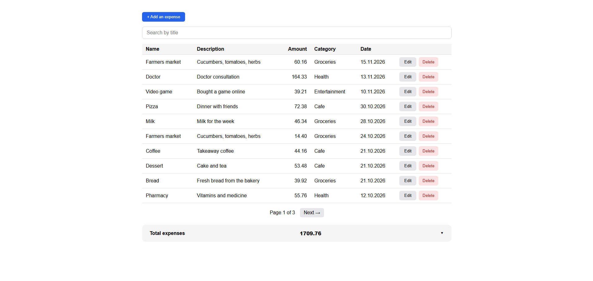

# Expense Tracker

A small Django web app for recording personal expenses. You can add, edit and delete expenses, see totals by category, filter and search the list, and browse it page by page.

I built it while learning Python and Django, to practice models, forms, views, templates and a bit of JavaScript in one real project.



## Features

- **Add, edit and delete expenses** in modal dialogs, without leaving the list page. Deleting asks for confirmation.
- **Validation and messages.** The amount must be greater than zero. Errors and successful actions are shown as messages on the page.
- **Collapsible summary.** The total is always visible and expands into totals per category.
- **Category filter.** Click a category in the summary to show only its expenses.
- **Live search by title.** The table updates as you type (debounced `fetch`, no page reload) and works together with the category filter.
- **Pagination.** 10 expenses per page; page links keep the current search and category.
- **Category suggestions.** The category field suggests existing categories, and a new one is created simply by typing it.
- **Empty state.** A friendly message when there are no expenses or nothing matches the search.
- **Test data command.** `python manage.py seed_expenses` fills the database with random expenses.

## Tech stack

- Python 3, Django
- SQLite
- HTML, CSS, vanilla JavaScript (no external libraries)

## Getting started

```
git clone https://github.com/VladyslavDub/expense-tracker.git
cd expense-tracker
python -m venv venv
venv\Scripts\activate
pip install django
python manage.py migrate
python manage.py runserver
```

On macOS or Linux, activate the environment with `source venv/bin/activate` instead.

Open http://127.0.0.1:8000/expenses/ in your browser.

### Optional: test data

```
python manage.py seed_expenses              # 40 random expenses
python manage.py seed_expenses --count 100  # choose how many
python manage.py seed_expenses --clear      # delete ALL expenses
```

Note that `--clear` removes every expense in the database.

### Optional: admin panel

```
python manage.py createsuperuser
```

Then log in at http://127.0.0.1:8000/admin/.

## Project structure

```
expense_tracker/
  config/                  project settings and root URLs
  expenses/
    models.py              Expense model
    forms.py               ExpenseForm with amount validation
    views.py               list, add, edit and delete views
    services.py           totals_by_category() logic, kept out of the views
    urls.py
    management/commands/
      seed_expenses.py     test data command
    templates/expenses/
      expenses_list.html   main page
      partials/            table, summary, pagination, dialogs, messages
    static/expenses/
      style.css
      app.js               modal dialogs and live search
```

The list page is split into small template partials so each part (table, summary, dialogs) lives in its own file. Calculation logic lives in `services.py` rather than in the views.

## What I would add next

- Monthly summary with a month picker
- User accounts, so everyone sees only their own expenses
- Automated tests
